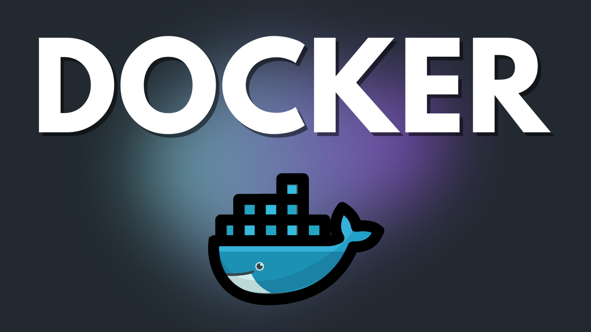
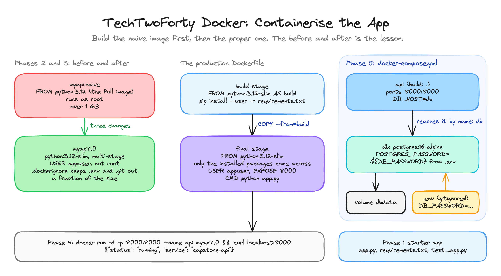

<p align="center">
  
</p>

<h1 align="center">TechTwoForty: Docker</h1>
<p align="center"><b>Containerise the App</b> · the finished project</p>
<p align="center">
  <a href="https://github.com/wjpearce-github/TechTwoForty-Terraform">← Previous: Terraform</a> ·
  <a href="https://github.com/wjpearce-github/TechTwoForty-Start-Here">Course map</a> ·
  <a href="https://github.com/wjpearce-github/TechTwoForty-Git">Next: Git →</a>
</p>

> [!TIP]
> **This repo is the finished template for the Docker project. Treat it as your cheat sheet.**
> `capstone-app/` is what your `~/capstone-app` folder should hold at the end: the starter API, its test, the production multi-stage Dockerfile, `.dockerignore` and the Compose stack. The naive Dockerfile from Phase 2 is kept alongside as `Dockerfile.naive`, so you can compare before and after.

| | |
|---|---|
| **Section** | 5 of 10 · Containers |
| **Time** | About 45 minutes, 5 phases |
| **Runs on** | Docker on your Ubuntu VM. No cloud costs |
| **Deliverable** | A small, non-root image tagged `myapi:1.0`, plus a two-service stack (API and Postgres) that starts with one command |

## The big picture



<sub>Drawn in Excalidraw. To edit it, open <code>assets/diagram.excalidraw</code> at <a href="https://excalidraw.com">excalidraw.com</a>.</sub>

## What is in this repo

```text
TechTwoForty-Docker/
├── .gitignore              .env, .venv and caches stay out of Git
└── capstone-app/
    ├── app.py              One endpoint: {"status": "running", "service": "capstone-api"}
    ├── requirements.txt    flask, pytest
    ├── test_app.py         One test. CI/CD runs it on every push
    ├── Dockerfile          Production: slim, multi-stage, USER appuser
    ├── Dockerfile.naive    The Phase 2 "before", for comparison only
    ├── .dockerignore       .git, .venv, .env and friends stay out of the image
    ├── docker-compose.yml  api + db, password from ${DB_PASSWORD}
    └── .env.example        Copy to .env. The real .env is never committed
```

> [!NOTE]
> In the walkthrough the production Dockerfile **replaces** the naive one in Phase 3, so your folder will not have `Dockerfile.naive` or `.env.example`. They are here to make the comparison easy.

## Cheat sheet, phase by phase

### Phase 1 · The starter app

```bash
docker version && docker run hello-world
mkdir ~/capstone-app && cd ~/capstone-app
code app.py
printf 'flask\npytest\n' > requirements.txt
code test_app.py
```

### Phase 2 · The naive Dockerfile (the before)

```bash
docker build -t myapi:naive . && docker images myapi
```

Look at the SIZE column. Probably over a gigabyte, and it runs as root. Write the number down.

### Phase 3 · The production Dockerfile (the after)

```bash
code Dockerfile
code .dockerignore
docker build -t myapi:1.0 . && docker images myapi
```

| Change | What it buys you |
|---|---|
| `python:3.12-slim` base | Far fewer packages, so far less to patch and attack |
| Multi-stage, `COPY --from=build /root/.local` | The packages come across, the tools that installed them do not |
| `USER appuser` | A compromised container is not root |
| `.dockerignore` | `.env` and `.git` can never be baked into a layer |

### Phase 4 · Run it

```bash
docker run -d -p 8000:8000 --name api myapi:1.0 && curl http://localhost:8000
docker logs api && docker stop api && docker rm api
```

**You should see:** `{"service":"capstone-api","status":"running"}`. That response is the capstone's heartbeat.

### Phase 5 · Add a database with Compose

```bash
code docker-compose.yml
echo "DB_PASSWORD=localdevpassword" > .env && docker compose up -d && docker compose ps
docker compose logs api && docker compose down -v
```

> [!IMPORTANT]
> `POSTGRES_PASSWORD=${DB_PASSWORD}` means the password is **not** in the YAML. Compose reads it from `.env`, which is gitignored. Typing the real password into the YAML is how it ends up in Git.

`down -v` also removes the database volume. Leave the `-v` off when you want the data to survive.

## Final handover check

- [ ] `myapi:1.0` is a fraction of the size of `myapi:naive`
- [ ] The image runs as `appuser`, not root (`docker run --rm myapi:1.0 whoami`)
- [ ] The Compose stack starts and stops cleanly
- [ ] No secret appears in any file that would go to Git

## Common mistakes

| Mistake | What happens | The fix |
|---|---|---|
| No `.dockerignore` | `.env` or `.git` gets baked into a layer, and layers never forget | Write it before you build |
| The password in `docker-compose.yml` | It ends up in Git | `${DB_PASSWORD}` from `.env` |
| `docker compose down -v` when you wanted the data | The database is gone | Drop the `-v` |
| Port already in use | `bind: address already in use` | `docker stop api && docker rm api` |

## What you can now do

- **Image building:** Dockerfiles, layers, tags and the build cache
- **Multi-stage builds:** ship the app, leave the build tools behind
- **Container security:** slim bases, non-root users, secrets kept out of layers
- **Compose:** a multi-service stack in YAML, started with one command

Keep `~/capstone-app`. The Git project copies it into `devsecops-capstone/app/`, and in the Security section a scanner shows in numbers what the slim base and non-root user saved you.

---

<p align="center">
  <b>TechTwoForty</b> · Docker · 5 of 10<br>
  <a href="https://github.com/wjpearce-github/TechTwoForty-Terraform">← Previous: Terraform</a> ·
  <a href="https://github.com/wjpearce-github/TechTwoForty-Start-Here">Course map</a> ·
  <a href="https://github.com/wjpearce-github/TechTwoForty-Git">Next: Git →</a>
</p>
